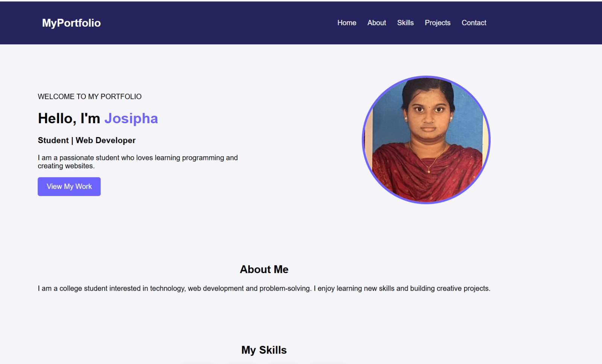

# Ex01 Portfolio
## Date:02.11.2026

## AIM
To create a Portfolio using HTML and CSS.

## ALGORITHM
### STEP 1
Create an HTML file (index.html)

### STEP 2
Create a CSS file (style.css)

### STEP 3
Include a navigation bar with links to different sections.

### STEP 4
Add structured sections for introduction, about, projects, and contact details.

### STEP 5
Define global styles for fonts, colors, and layout.

### STEP 6
Style the header, navigation bar, and sections.

### STEP 7
Use Flexbox or CSS Grid for layout design.

### STEP 8
Add hover effects and transitions for interactivity.

### STEP 9
Add Images and Media.

### STEP 10
Use optimized images for a professional look.

### STEP 11
Open the HTML file in a browser to check layout and functionality.

### STEP 12
Fix styling issues and refine content placement.

### STEP 13
Deploy the Portfolio.

### STEP 14
Upload to GitHub Pages for free hosting.

## PROGRAM
```

<!DOCTYPE html>
<html lang="en">
<head>
    <meta charset="UTF-8">
    <meta name="viewport" content="width=device-width, initial-scale=1.0">
    <title>My Portfolio</title>

    <style>
        body {
            margin: 0;
            font-family: Arial, sans-serif;
            background: #f4f4f9;
        }

        header {
            background: #25245c;
            padding: 15px;
            color: white;
        }

        nav {
            display: flex;
            justify-content: space-around;
            align-items: center;
            flex-wrap: wrap;
        }

        nav ul {
            display: flex;
            list-style: none;
            gap: 25px;
        }

        nav a {
            color: white;
            text-decoration: none;
        }

        .hero {
            display: flex;
            align-items: center;
            justify-content: space-around;
            padding: 70px 10%;
            flex-wrap: wrap;
            gap: 30px;
        }

        .hero-content {
            max-width: 500px;
        }

        .hero h1 span {
            color: #6c63ff;
        }

        .hero-image img {
            width: 280px;
            height: 280px;
            object-fit: cover;
            border-radius: 50%;
            border: 5px solid #6c63ff;
        }

        .btn {
            display: inline-block;
            background: #6c63ff;
            color: white;
            padding: 12px 20px;
            text-decoration: none;
            border-radius: 5px;
        }

        .section {
            text-align: center;
            padding: 40px 10%;
        }

        .skills-container,
        .projects-container {
            display: flex;
            justify-content: center;
            gap: 20px;
            flex-wrap: wrap;
        }

        .skill, .project-card {
            background: white;
            padding: 20px;
            border-radius: 10px;
            box-shadow: 0 2px 8px #ccc;
        }

        footer {
            background: #25245c;
            color: white;
            text-align: center;
            padding: 15px;
        }

        @media(max-width: 600px) {
            nav ul {
                gap: 10px;
                padding: 0;
            }

            .hero {
                flex-direction: column;
                text-align: center;
            }
        }
    </style>
</head>

<body>

    <!-- Navigation -->
    <header>
        <nav>
            <h2>MyPortfolio</h2>

            <ul>
                <li><a href="#home">Home</a></li>
                <li><a href="#about">About</a></li>
                <li><a href="#skills">Skills</a></li>
                <li><a href="#projects">Projects</a></li>
                <li><a href="#contact">Contact</a></li>
            </ul>
        </nav>
    </header>

    <!-- Home Section -->
    <section id="home" class="hero">

        <div class="hero-content">
            <p>WELCOME TO MY PORTFOLIO</p>

            <h1>Hello, I'm <span>Josipha</span></h1>

            <h3>Student | Web Developer</h3>

            <p>
                I am a passionate student who loves learning
                programming and creating websites.
            </p>

            <a href="#projects" class="btn">View My Work</a>
        </div>

        <!-- Profile Image -->
        <div class="hero-image">
            
        </div>

    </section>

    <!-- About Section -->
    <section id="about" class="section">
        <h2>About Me</h2>

        <p>
            I am a college student interested in technology,
            web development and problem-solving. I enjoy
            learning new skills and building creative projects.
        </p>
    </section>

    <!-- Skills Section -->
    <section id="skills" class="section">
        <h2>My Skills</h2>

        <div class="skills-container">
            <div class="skill">HTML</div>
            <div class="skill">CSS</div>
            <div class="skill">Java</div>
            <div class="skill">Python</div>
        </div>
    </section>

    <!-- Projects Section -->
    <section id="projects" class="section">
        <h2>My Projects</h2>

        <div class="projects-container">

            <div class="project-card">
                <h3>Personal Portfolio</h3>
                <p>A website to showcase my skills and achievements.</p>
            </div>

            <div class="project-card">
                <h3>Student Management</h3>
                <p>A simple project to organize student information.</p>
            </div>

            <div class="project-card">
                <h3>Hostel Management</h3>
                <p>A project to simplify hostel accommodation management.</p>
            </div>

        </div>
    </section>

    <!-- Contact Section -->
    <section id="contact" class="section">
        <h2>Contact Me</h2>

        <p>Email: josipha.21@gmail.com</p>
        <p>Phone: 9789265527</p>

        <a href="mailto:josipha.21@gmail.com" class="btn">
            Send Email
        </a>
    </section>

    <!-- Footer -->
    <footer>
        <p>&copy; 2026 Josipha | My Portfolio</p>
    </footer>

</body>
</html>
```

## OUTPUT


## RESULT
The program for creating Portfolio using HTML and CSS is executed successfully.
